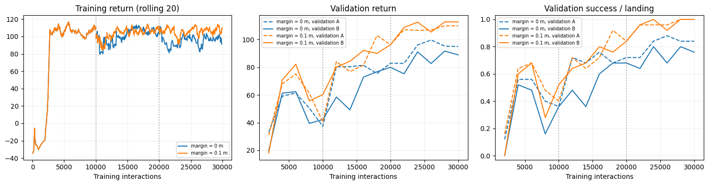
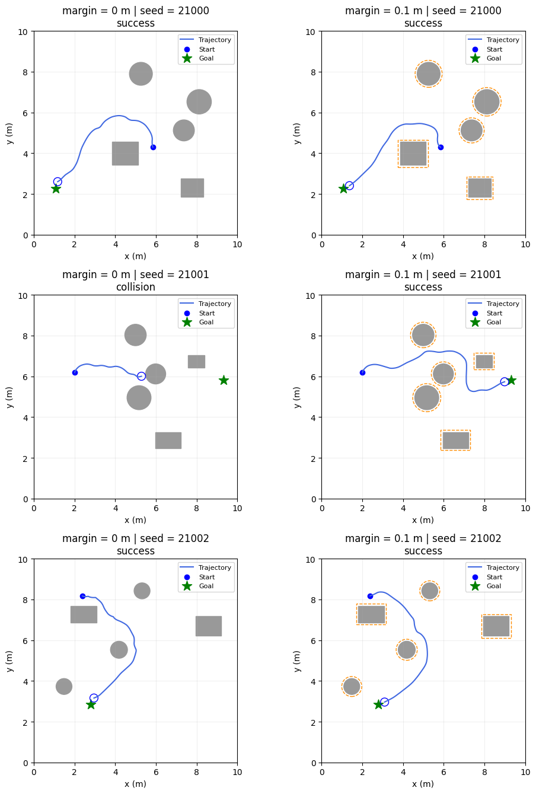
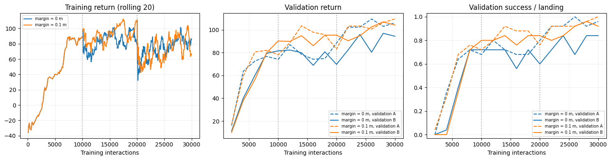
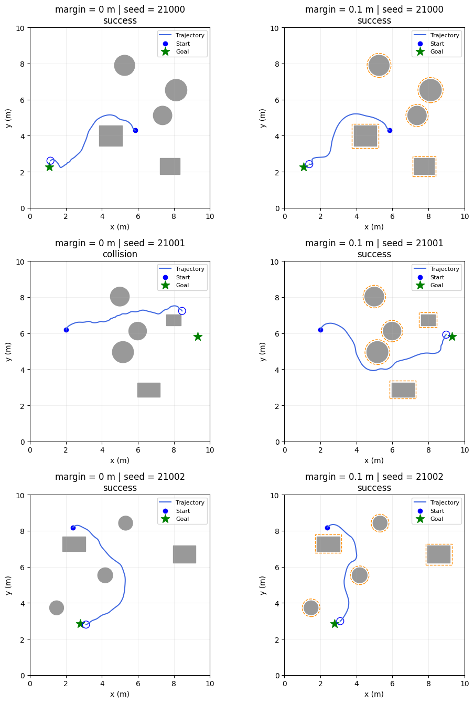
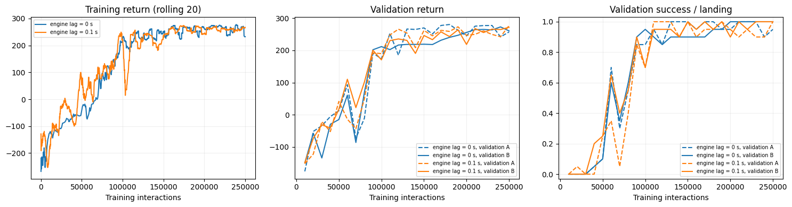
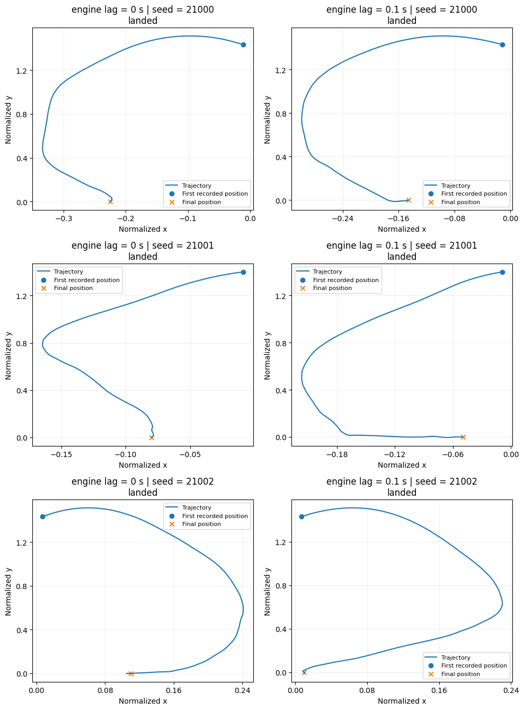

# Reinforcement Learning for Navigation and Control

A modular Python project for applying reinforcement learning algorithms to
navigation and control tasks. The current examples use **Soft Actor-Critic (SAC)**
and **Proximal Policy Optimization (PPO)** with two environments: obstacle
navigation and continuous LunarLander.

Reusable Python modules implement the environments, experiment configuration,
training, evaluation, and visualization. Short notebooks define experiment
parameters and call these modules. Algorithm implementations are provided by
[Stable-Baselines3](https://stable-baselines3.readthedocs.io/en/v2.7.1/).
Both algorithms use two 256-unit ReLU hidden layers (SB3's PPO default activation is Tanh).

## Examples

| Task | Observation | Action | Comparison |
|---|---|---|---|
| Obstacle navigation | 36 LiDAR beams, relative goal, previous commanded velocities | Local 2D waypoint | Observation margin = 0 vs. 0.1 m |
| Continuous LunarLander | Eight native observations and two engine-command states | Main and side engine commands | Engine-command lag = 0 vs. 0.1 s |

Navigation uses a fixed unicycle controller to execute waypoints among circular
and rectangular obstacles. The optional curriculum increases obstacle count;
validation always uses three circles and two rectangles. Observation margins
change perceived obstacle geometry without changing physical collisions.

LunarLander retains Gymnasium physics and rewards. A first-order filter modifies
engine commands, with its internal state exposed to the policy. The filter models
command lag rather than physical thrust dynamics.

| Algorithm | Navigation notebook | LunarLander notebook |
|---|---|---|
| SAC | [navigation_sac.ipynb](notebooks/navigation_sac.ipynb) | [lunarlander_sac.ipynb](notebooks/lunarlander_sac.ipynb) |
| PPO | [navigation_ppo.ipynb](notebooks/navigation_ppo.ipynb) | [lunarlander_ppo.ipynb](notebooks/lunarlander_ppo.ipynb) |

Environment equations: [Navigation](docs/navigation.md) · [LunarLander](docs/lunarlander.md).

## Requirements

- Python 3.10 or newer.
- Gymnasium 1.2.3 with Box2D and Stable-Baselines3 2.7.1.
- PyTorch, NumPy, pandas, Matplotlib, ImageIO, and ImageIO-FFmpeg.
- SWIG installed before Box2D. Platforms that build Box2D from source also need a C++ compiler.
- Jupyter/IPython for notebooks; pytest for tests. CPU execution is the default.

Dependency constraints are defined in [requirements.txt](requirements.txt) and
[pyproject.toml](pyproject.toml).

## Installation

Clone the repository and install the package from the project root:

```bash
git clone <repository-url>
cd rl_examples
python -m pip install "swig>=4.2,<5"
python -m pip install -e ".[notebooks,test]"
```

Alternatively, use **Code → Download ZIP** and run the install commands from the
extracted folder.

### Google Colab and Drive

1. Upload the project folder to `MyDrive/rl_examples`.
2. Open an example notebook in Colab.
3. Run the setup cell to mount Drive and install the package. Set `PROJECT` to
   the actual project root if a different folder name or location is used.
4. Run with `SMOKE_ONLY=True` to check the pipeline.
5. Set `SMOKE_ONLY=False` and rerun the configuration cell onward for training.

The setup cell explicitly registers the package path, allowing imports in the
same runtime after editable installation. Restart the runtime after replacing
Python source files that have already been imported.

## Project layout

| Directory | Purpose |
|---|---|
| `rl_examples/algorithms/` | SAC/PPO agent creation and loading |
| `rl_examples/models/` | Neural-network architecture settings |
| `rl_examples/configs/` | Environment, algorithm, and training parameters |
| `rl_examples/environments/` | Dynamics, sensing, collision checks, and wrappers |
| `rl_examples/training/` | Training loops, curriculum, validation, and checkpoints |
| `rl_examples/evaluation/` | Metrics and checkpoint comparisons |
| `rl_examples/simulation/` | Policy rollouts and video recording |
| `rl_examples/visualization/` | Learning curves and trajectory comparisons |
| `rl_examples/utils/` | File handling and presentation labels |
| `notebooks/` | Configurable task examples |
| `tests/` | Environment and pipeline regression tests |
| `scripts/` | Command-line pipeline checks |
| `docs/` | Environment models and demonstration guidance |
| `outputs/` | Generated checkpoints, tables, figures, and videos; excluded from Git |

## Training and evaluation

Configure the experiment in the notebook:

| Parameter | Purpose |
|---|---|
| `SMOKE_ONLY` | Short execution check or full training |
| `MODE` | `train` creates a run; `load` opens a completed run |
| `RUN_NAME` | Experiment directory name |
| `conditions` | Environment settings for each comparison |
| `agent_config` | SAC/PPO hyperparameters and network widths |
| `training_config` | Interaction budget, seeds, validation intervals, and stopping |
| `USE_CURRICULUM` | Navigation curriculum or direct training with all obstacles |

Each condition uses an independent agent. Validation A tracks learning;
validation B selects the checkpoint. Navigation ranks success rate first and
mean return second. LunarLander ranks mean return. Selected and final checkpoints
are evaluated separately. The held-out test remains disabled until settings are fixed.

Success means goal completion for navigation and settled landing for LunarLander.
Path length, duration, and engine use are compared on common successful scenarios.
Multiple training seeds are required to assess variability; a single run is exploratory.

Run files are stored in `outputs/<run>/<condition>/seed_<seed>/`. They include
configuration and package versions, training logs, validation CSVs, best/latest/final
models, stage checkpoints, and completion metadata. Existing runs are protected
from overwrite. `MODE="load"` requires matching configuration. Exact training
resumption after interruption is not implemented; saved models support inference.

## Results

### Navigation

Results from a single training seed (42) with 30,000 interactions per condition
(three 10,000-step curriculum stages). Scores are measured on the 25 validation B
scenarios, which also selected each checkpoint, so they are optimistic estimates.
The held-out test has not been run. With 25 scenarios, one episode changes a rate
by 4 percentage points.

| Algorithm | Margin | Selected checkpoint | Success | Collision | Timeout | Mean return |
|---|---|---|---|---|---|---|
| SAC | 0 m | 28,000 steps | 80% | 8% | 12% | 91.7 |
| SAC | 0.1 m | 30,000 steps | 100% | 0% | 0% | 112.7 |
| PPO | 0 m | 28,000 steps | 84% | 12% | 4% | 96.9 |
| PPO | 0.1 m | 28,000 steps | 96% | 4% | 0% | 107.0 |

Efficiency on scenarios solved under both margins:

| Algorithm | Common successes | Decisions (0 m → 0.1 m) | Path length (0 m → 0.1 m) |
|---|---|---|---|
| SAC | 20 | 24.3 → 20.0 | 8.17 m → 7.24 m |
| PPO | 21 | 35.1 → 29.6 | 8.54 m → 8.17 m |

In this run, the 0.1 m observation margin produced higher success rates, fewer
collisions, and shorter paths for both algorithms. SAC reached the goal in fewer
decisions than PPO. Multiple training seeds and the held-out test are needed
before treating these differences as general.

<details>
<summary>SAC learning curves and trajectories</summary>




</details>

<details>
<summary>PPO learning curves and trajectories</summary>




</details>

### LunarLander

SAC results from a single training seed (42) with 250,000 interactions per
condition. Early stopping was enabled but did not trigger. Scores are measured on
the 20 validation B scenarios, which also selected each checkpoint; the held-out
test has not been run. With 20 scenarios, one episode changes a rate by 5
percentage points.

| Algorithm | Engine lag | Selected checkpoint | Landed | Failed | Timeout | Mean return |
|---|---|---|---|---|---|---|
| SAC | 0 s | 240,000 steps | 100% | 0% | 0% | 272.6 |
| SAC | 0.1 s | 250,000 steps | 100% | 0% | 0% | 271.4 |

Efficiency on scenarios landed under both conditions (20 of 20):

| Algorithm | Steps (0 s → 0.1 s) | Main-engine use (0 s → 0.1 s) | Side-engine use (0 s → 0.1 s) |
|---|---|---|---|
| SAC | 209.9 → 234.8 | 1.79 → 2.01 power·s | 0.67 → 0.37 power·s |

In this run, both SAC policies landed in every validation scenario with nearly
identical returns. With the 0.1 s command lag, episodes took about 12% longer
(25 more steps, 0.5 s) and used more main-engine power but less side-engine power.

<details>
<summary>SAC learning curves and trajectories</summary>




</details>

PPO results will be added after training is complete.

## Trajectories and videos

Each notebook plots three matched scenarios across both conditions. Set
`RECORD_VIDEOS=True` after training to export two scenarios per condition as
MP4 files, PNG previews, and JSON metadata under `outputs/<run>/videos/`.

Selected demonstrations can be presented in the README as preview images linked
to videos. Copy the chosen files to `docs/media/`, then use a relative link such as:

```markdown
[](docs/media/navigation_sac.mp4)
```

The image and link resolve once those files are added. Demonstrations
should identify the algorithm, condition, scenario seed, checkpoint, and outcome.
No trained-policy footage is bundled. See [video guidance](docs/videos.md).

## Tests

```bash
python -m pytest -q
python scripts/smoke_test.py
```

Smoke mode checks execution rather than convergence. Test scope and verification
results are documented in [VALIDATION.md](VALIDATION.md).

## References

- [SAC documentation](https://stable-baselines3.readthedocs.io/en/v2.7.1/modules/sac.html)
- [PPO documentation](https://stable-baselines3.readthedocs.io/en/v2.7.1/modules/ppo.html)
- [Gymnasium LunarLander](https://gymnasium.farama.org/environments/box2d/lunar_lander/)

## License

Released under the [MIT License](LICENSE).
